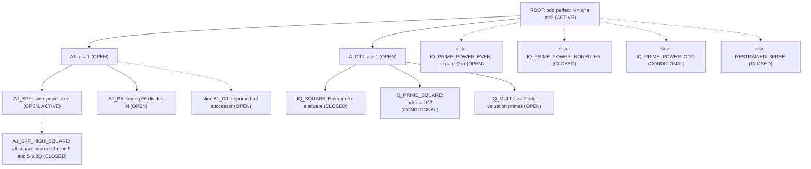

# Branch map: the case tree for `¬ existsOddPerfect`

**This is the unit of progress.** Every hypothetical odd perfect number N = q^a m² (Euler form) falls into the partition nodes below.
- A node is `CLOSED` only when an audited Lean theorem derives `False` on it.
- A node is `CONDITIONAL` when such a theorem exists but takes a named, unproved hypothesis.
- Everything else is `OPEN`.

Restrictions such as floors, counts and residue classes are recorded on the node. When one excludes a slice, record its defining arithmetic hypotheses and the previously surviving family that motivated it. Its parent retains its own status.

Two kinds of node:
- `partition`: the children cover the parent exactly.
- `slice`: a cross-cutting subfamily that is tracked separately because a specific method applies to it.

Rules:
- At most **3** nodes are `active: true`. Each active node names its missing ingredient and owner.
- Lean theorems that close or restrict a node cite its `id` in their docstring (`BRANCH_MAP: <id>`).
- The JSON block below is read by `research/tools/evaluate_progress.py` and `research/tools/claims.py`. Keep it valid JSON.

## Overview



## Machine-readable tree

```json
{
  "nodes": [
    {"id": "ROOT", "kind": "partition", "parent": null, "status": "OPEN", "active": true,
     "missing": "A bound on incoming target capacity that survives arbitrary exponents, or a different argument for candidates with few exact squares (IDEAS 7).", "owner": "Carbon Strategist",
     "description": "Odd perfect N in Euler form q^a m^2, q ≡ a ≡ 1 (mod 4).",
     "lean": ["euler_form"], "floors": "N > 10^300, ω ≥ 6, Ω ≥ 37 (frontier: 10^1500, ω ≥ 10, Ω ≥ 101)"},
    {"id": "A1", "kind": "partition", "parent": "ROOT", "status": "OPEN", "active": false,
     "description": "Euler exponent a = 1. Then m^2 is odd deficient-perfect with omitted divisor i_q (Tóth pair with prime multiplier q).",
     "lean": ["linear_euler_unique_q_source_and_bound", "universal_half_succ_index_gcd_square_parametrization"]},
    {"id": "A1_SPF", "kind": "partition", "parent": "A1", "status": "OPEN", "active": true,
     "description": "Sixth-power-free (forces a = 1; every other exponent is 2 or 4; least prime ≥ 53).",
     "lean": ["sixth_power_free_euler_exponent_one", "sixth_power_or_large_support", "sixth_power_free_oneModThreeLarge_ge_80", "OddPerfect.SquareOutputCapacity.sixth_power_free_square_output_capacity"],
     "floors": "ω ≥ 443, Ω ≥ 1179, N > 10^3136, |Q13| ≥ 80, E ≥ 221",
     "missing": "Use residue-labelled factor partitions to distinguish the lower-square-count family surviving the modulo-five bound (IDEAS 8).",
     "owner": "Carbon Strategist"},
    {"id": "A1_SPF_HIGH_SQUARE", "kind": "slice", "parent": "A1_SPF", "status": "CLOSED", "active": false,
     "description": "All exponent-two prime sources are 1 mod 5 (U = 0) and their number S is at least twice the number Q of exponent-four primes that are 1 mod 3.",
     "lean": ["OddPerfect.SquareOutputCapacity.no_high_square_count_of_all_one_mod_five"]},
    {"id": "A1_P6", "kind": "partition", "parent": "A1", "status": "OPEN", "active": false,
     "description": "a = 1 and some prime p has p^6 | N."},
    {"id": "A1_G1", "kind": "slice", "parent": "A1", "status": "OPEN", "active": false,
     "description": "a = 1 and gcd((q+1)/2, i_q) = 1 (coprime half-successor): u² = W σ(h²), σ(u²) = W(2h² − 1).",
     "lean": ["linear_euler_coprime_half_succ_quotient_system"],
     "missing": "A descent (strictly smaller solution of the same system) or a size contradiction on (h, u, W).",
     "owner": "Carbon Strategist"},
    {"id": "A_GT1", "kind": "partition", "parent": "ROOT", "status": "OPEN", "active": false,
     "description": "Euler exponent a > 1. Split by the odd-valuation primes of the Euler index I = σ(m²)/q^a."},
    {"id": "IQ_SQUARE", "kind": "partition", "parent": "A_GT1", "status": "CLOSED", "active": false,
     "description": "I is a square.", "lean": ["euler_index_not_square_of_exponent_gt_one"]},
    {"id": "IQ_PRIME_SQUARE", "kind": "partition", "parent": "A_GT1", "status": "CONDITIONAL", "active": false,
     "description": "I = ℓ t² with ℓ prime; reduces to q^d + 1 = 2y², d = (a+1)/2 prime ≥ 17.",
     "lean": ["euler_index_ne_prime_mul_square_of_fermat_obstruction"],
     "hypothesis": "ExceptionalFermatObstruction (OddPerfect/ExceptionalFermatReduction.lean)",
     "note": "Residue sieves cannot finish ((q,y) = (1,1) survives every modulus; NO_GO §2). Hirakawa Lemma 2.5 supplies the published result. The local Lean reduction retains an explicit premise."},
    {"id": "IQ_MULTI", "kind": "partition", "parent": "A_GT1", "status": "OPEN", "active": false,
     "description": "I has at least two primes of odd valuation."},
    {"id": "IQ_PRIME_POWER_NONEULER", "kind": "slice", "parent": "ROOT", "status": "CLOSED", "active": false,
     "description": "Some non-Euler component index i_r (r ≠ q) is a prime power.",
     "lean": ["component_prime_power_index_euler_only_and_septuple_lift"]},
    {"id": "IQ_PRIME_POWER_ODD", "kind": "slice", "parent": "ROOT", "status": "CONDITIONAL", "active": false,
     "description": "Euler index i_q = p^j with j odd.",
     "hypothesis": "ExceptionalFermatObstruction (componentIndex_ne_odd_prime_power_of_fermat_obstruction)"},
    {"id": "IQ_PRIME_POWER_EVEN", "kind": "slice", "parent": "ROOT", "status": "OPEN", "active": false,
     "description": "Euler index i_q = p^(2u) (forces a = 1, q = σ(p^(2u)), q + 1 = 2s², σ(s²) = p^(2u)).",
     "lean": ["even_prime_power_component_size_gt_ten_pow_353234555955090756", "even_prime_power_component_base_lt_six_pow", "even_index_base_subexponential"],
     "floors": "2u ≥ 1.3·10^16, p ≥ 10^27, ≥ 13 repunit bases",
     "missing": "A descent or an upper bound on u quantitatively incompatible with the known p-bounds.",
     "owner": "Carbon Strategist"},
    {"id": "RESTRAINED_3FREE", "kind": "slice", "parent": "ROOT", "status": "CLOSED", "active": false,
     "description": "3 ∤ N and at most one non-Euler prime r ≠ 3 with exponent ≥ 4.",
     "lean": ["two_le_largeSources_of_three_free"],
     "note": "Ochem–Zelinsky §2 covers one exceptional even exponent, Steuerwald covers zero. The local proof is an alternative derivation."},
    {"id": "RELATED", "kind": "slice", "parent": null, "status": "OPEN", "active": false,
     "description": "Results on neighbouring classes (near-perfect, deficient-perfect, harmonic, spoofs). Not part of the case tree."}
  ]
}
```

## How a node changes status

1. A Lean theorem with conclusion `False` (or `x ∉ node`) under exactly the node's hypotheses passes `lake build && lake lean research/Audit.lean`.
2. `neon-auditor` confirms that the theorem's hypotheses match the node description word for word.
3. The Strategist updates the JSON above, adds the theorem to [claims_registry.json](claims_registry.json), and records the change in [LEDGER.md](LEDGER.md) under **Branch impact**.
